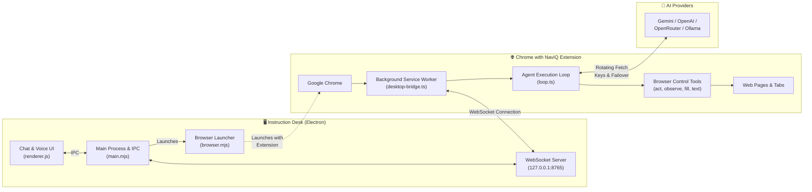

# NaviQ - Autonomous AI Web Automation Platform

> **NaviQ** is an end-to-end, multi-agent AI browser automation system consisting of a cross-platform Electron desktop control desk and a Manifest V3 Chromium browser extension. It enables users to automate complex web browsing tasks via natural language or voice commands, utilizing multi-provider LLMs, intelligent DOM perception, automatic API key rotation, dual-model quota failover, and browser profile isolation.

---

## 📑 Table of Contents

- [Overview](#-overview)
- [System Architecture](#-system-architecture)
- [Key Features](#-key-features)
- [Repository Structure](#-repository-structure)
- [Quick Start](#-quick-start)
  - [Prerequisites](#prerequisites)
  - [Installation & Build](#installation--build)
  - [Running NaviQ](#running-naviq)
- [Core Components](#-core-components)
  - [1. Instruction Desk (Electron App)](#1-instruction-desk-electron-desktop-app)
  - [2. Nanobrowser (Chrome Extension)](#2-nanobrowser-extension)
- [Supported LLM Providers](#-supported-llm-providers)
- [Security & Human-in-the-Loop](#-security--human-in-the-loop)
- [Documentation Index](#-documentation-index)
- [License](#-license)

---

## 🌟 Overview

NaviQ bridges modern generative AI models with real-world web browsing capabilities. Rather than executing simple synthetic clicks, NaviQ uses deep DOM accessibility trees, visual perception, semantic element labeling, and full keyboard/pointer emulation to navigate websites, research topics, fill complex forms, extract data, handle file uploads, and execute multi-step workflows.

The system is split into two interconnected subsystems:
1. **Instruction Desk (`instruction-desk`)**: A high-performance Electron desktop console featuring a sleek chat UI, voice recognition engine (powered by Gemini multimodal audio transcription), Chrome profile selection, session history, and live tool execution telemetry.
2. **Nanobrowser Extension (`nanobrowser`)**: A Manifest V3 extension loaded directly into Chrome via Puppeteer. It runs an autonomous agent loop in its background service worker with full access to Chrome tabs, DevTools protocols, and DOM manipulation tools.

Both halves communicate through a local, bi-directional WebSocket bridge running at `ws://127.0.0.1:8765`.



---

## ⚡ Key Features

- **🗣️ Real-Time Voice Commands**: Integrated speech-to-text supporting WebSpeech API and high-accuracy Gemini multimodal audio transcription (`gemini-3.1-flash-lite` / `gemini-3.5-flash-lite`).
- **🔄 Multi-Key Rotation & Dual-Model Failover**: Seamlessly cycles through a pool of API keys upon encountering rate limits (HTTP 429) or quota depletion (`RESOURCE_EXHAUSTED`). Automatically falls back to secondary models if primary quotas expire.
- **🛡️ Human-in-the-Loop Safety Modes**:
  - **Ask Mode (Default)**: Harmless reads and clicks proceed automatically, but destructive or sensitive actions (submitting payments, entering passwords, deletions, uploads) trigger interactive desktop confirmation prompts.
  - **Auto Mode**: Executes uninterrupted workflows with strict guardrails against prompt injection and cross-site credential leakage.
- **👥 Browser Profile Isolation & Seeding**: Run completely clean, isolated sessions or clone bookmarks, preferences, and session state from your existing Chrome user profiles without corrupting your daily browsing environment.
- **📎 Multimodal File Attachments**: Drag-and-drop text documents, PDFs, or images into the chat. Files are automatically ingested into IndexedDB blob storage and made available to the agent for inspection or web form uploading.
- **🧩 Live Execution Telemetry**: Real-time status badges, tool invocation argument tracking, and streaming token-by-token thought processes directly in the desktop desk.
- **💾 Full Chat Session Management**: Persist, name, search, reload, and export agent sessions into formatted Markdown files.

---

## 📁 Repository Structure

```text
nano/
├── instruction-desk/             # Electron Desktop Application
│   ├── assets/                   # App icons and branding graphics
│   ├── browser.mjs               # Chrome Puppeteer launcher & profile manager
│   ├── index.html                # Desk UI layout and docking controls
│   ├── main.mjs                  # Electron main process, IPC & WebSocket server
│   ├── package.json              # Desktop dependencies and scripts
│   ├── preload.cjs               # Secure ContextBridge IPC exposure
│   ├── renderer.js               # Reactive desk UI logic, voice & session manager
│   └── scripts/                  # Asset & icon generator scripts
│
├── nanobrowser/                  # Chrome Extension (Manifest V3)
│   ├── entrypoints/              # Extension entrypoints (background, options, sidepanel)
│   ├── fixtures/                 # Local test servers and automated evaluation harness
│   ├── src/
│   │   ├── agent/                # Agent loop, compaction, elision, context builder
│   │   ├── background/           # Background service worker orchestration
│   │   ├── browser-control/      # Browser tools: observe, act, fill, navigate, text
│   │   ├── extension/            # Desktop bridge, run manager, permissions
│   │   ├── llm/                  # Providers, rotating fetch, token normalization
│   │   ├── store/                # Storage schemas (WXT storage & IndexedDB)
│   │   └── ui/                   # Shared UI components and protocol schemas
│   ├── package.json              # Extension dependencies and scripts
│   └── wxt.config.ts             # WXT framework build configuration
│
├── docs/                         # Detailed Technical Documentation
│   ├── ARCHITECTURE.md           # System architecture, protocols, and dataflow
│   ├── DESKTOP_APP.md            # Instruction Desk Electron application guide
│   ├── BROWSER_EXTENSION.md      # Nanobrowser extension internals & security
│   ├── AGENT_AND_TOOLS.md        # Agent tools, perception engine, and prompt loop
│   ├── API_AND_INTEGRATION.md    # LLM configuration, multi-key rotation, failover
│   └── DEVELOPMENT_GUIDE.md      # Build procedures, test harness, and debugging
│
└── README.md                     # Master documentation (this file)
```

---

## 🚀 Quick Start

### Prerequisites

- **Node.js**: v20+ (Node.js v24 recommended)
- **pnpm**: v9 or v10 (`npm install -g pnpm`)
- **Google Chrome**: Stable version installed on Windows, macOS, or Linux.

### Installation & Build

1. **Install dependencies for the extension and build it**:
   ```bash
   cd nanobrowser
   pnpm install
   pnpm build
   ```
   *This compiles the extension into `nanobrowser/dist`.*

2. **Install dependencies for the desktop app**:
   ```bash
   cd ../instruction-desk
   pnpm install
   ```

### Running NaviQ

Start the desktop application from `instruction-desk`:
```bash
pnpm start
```

When NaviQ launches:
1. The Electron desktop window appears.
2. A WebSocket server starts on `127.0.0.1:8765`.
3. Chrome is automatically launched in a separate window with the compiled NaviQ extension pre-loaded.
4. The extension automatically establishes a WebSocket connection with the desktop.
5. You can now type or speak your instruction in the desktop chat!

---

## 🧩 Core Components

### 1. Instruction Desk (Electron Desktop App)

The Instruction Desk is the command center of the system:
- **WebSocket Gateway (`127.0.0.1:8765`)**: Coordinates commands sent to the browser extension and receives streaming events, tool execution states, and tab updates.
- **Browser Automation Launcher (`browser.mjs`)**: Locates Google Chrome automatically or via `CHROME_PATH`, clones or isolates profiles, and attaches the extension folder (`--load-extension=../nanobrowser/dist`).
- **Gemini Audio Transcription**: High-fidelity speech-to-text engine using Gemini's native multimodal audio capabilities with fallback chains (`gemini-3.1-flash-lite` -> `gemini-3.5-flash-lite` -> `gemini-2.5-flash`).
- **Session History & File Manager**: Complete local session persistence, drag-and-drop file ingestion, and markdown export.

👉 *See [docs/DESKTOP_APP.md](docs/DESKTOP_APP.md) for full implementation details.*

### 2. Nanobrowser Extension

The Nanobrowser extension operates inside Chromium:
- **Run Manager (`run-manager.ts`)**: Controls concurrent agent sessions, manages tab grouping, handles task cancellation, and routes events back through the bridge.
- **Desktop Bridge (`desktop-bridge.ts`)**: Keeps a persistent WebSocket connection to the Electron app, automatically syncing settings, providers, API keys, and commands.
- **Perception Engine (`observe.ts`)**: Parses the DOM into an interactive element graph, creates bounding box maps, attaches numeric element IDs, and filters out hidden or occluded nodes.
- **Action Execution (`act.ts`, `fill.ts`)**: Emulates human interactions including typing with realistic key events, scrolling, selecting dropdowns, and file uploads.

👉 *See [docs/BROWSER_EXTENSION.md](docs/BROWSER_EXTENSION.md) and [docs/AGENT_AND_TOOLS.md](docs/AGENT_AND_TOOLS.md) for technical deep-dives.*

---

## 🤖 Supported LLM Providers

NaviQ features plug-and-play support for cloud and local models:

| Provider | Preset Default Model | Fallback Model | Key Rotation | Local / Cloud |
| :--- | :--- | :--- | :---: | :---: |
| **Google Gemini** | `gemini-3.1-flash-lite` | `gemini-3.5-flash-lite` | ✅ Yes | Cloud |
| **OpenRouter** | `meta-llama/llama-3.3-70b-instruct:free` | `google/gemini-2.0-flash-exp:free` | ✅ Yes | Cloud |
| **OpenAI** | `gpt-4o-mini` | `gpt-3.5-turbo` | ✅ Yes | Cloud |
| **Local Ollama** | `llama3.2` | `llama3.1` | N/A | Local |
| **Custom Endpoint** | User Defined | User Defined | ✅ Yes | Any OpenAI API |

Users can input **multiple API keys** separated by commas or newlines. The system monitors quota and rate limits in real-time, automatically switching to the next available key without interrupting active agent tasks.

👉 *See [docs/API_AND_INTEGRATION.md](docs/API_AND_INTEGRATION.md) for setup guides.*

---

## 🛡️ Security & Human-in-the-Loop

NaviQ is built around a safety-first paradigm:

- **Isolated Execution**: By default, NaviQ operates within a sandboxed Chrome profile directory (`NaviQ/chrome-profiles/default-isolated`), protecting your main browser cookies and passwords from accidental modification.
- **Sensitive Action Gatekeeper**: Destructive operations (payment forms, authentication inputs, account deletions) trigger an explicit approval request on the desktop UI.
- **Prompt Injection Defense**: Web content is treated strictly as untrusted observation data. The agent's prompt boundary prevents instructions contained in web page DOM from hijacking the agent's core goal.

---

## 📚 Documentation Index

For in-depth guides, architectural blueprints, and developer references, explore the documentation suite:

1. [**System Architecture & Protocols**](docs/ARCHITECTURE.md) - Deep dive into IPC, WebSocket bridge, data contracts, and event streams.
2. [**Instruction Desk Guide**](docs/DESKTOP_APP.md) - Electron process lifecycle, profile cloning, audio pipeline, and renderer UI.
3. [**Browser Extension Guide**](docs/BROWSER_EXTENSION.md) - Manifest V3 architecture, service worker lifecycle, storage, and bridge.
4. [**Agent & Tool Catalog**](docs/AGENT_AND_TOOLS.md) - Complete tool documentation, schema, perception engine, and compaction loop.
5. [**API & LLM Integration**](docs/API_AND_INTEGRATION.md) - Multi-key rotation, failover strategies, and provider configuration.
6. [**Developer & Testing Guide**](docs/DEVELOPMENT_GUIDE.md) - Setup, build system, automated test suite, and debugging techniques.

---

## 📄 License

The NaviQ project is licensed under the [Apache-2.0 License](nanobrowser/LICENSE).
