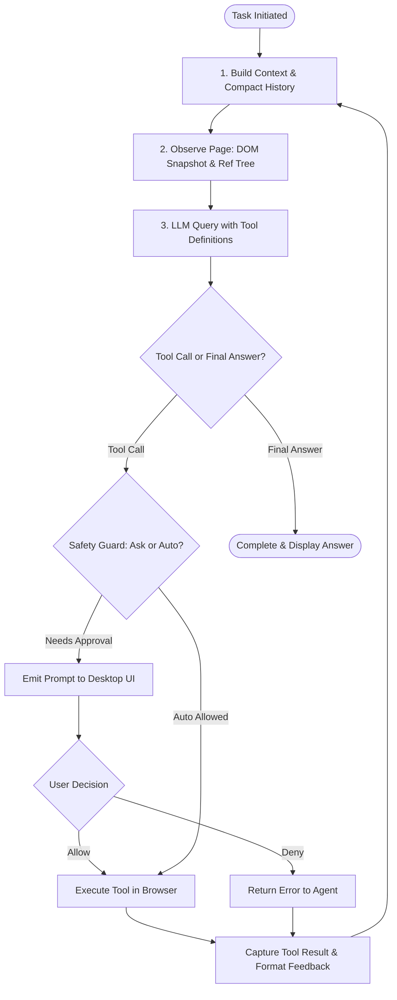

# Agent Loop & Tools Reference

The **Agent Execution Engine** is the brain of NaviQ. It operates an iterative reasoning loop where the LLM inspects the page state, decides which action to take, executes tools via browser-control interfaces, and processes feedback.

---

## 1. Agent Execution Loop (`loop.ts`)

### Context Compaction & Sliding Window (`compaction.ts`)
As web exploration proceeds, conversation history accumulates dozens of DOM snapshots and tool outputs. To avoid token overflow:
1. **Tool Output Elision**: Older DOM observations are trimmed, retaining only the summary or extracted text.
2. **Conversation Compaction**: When history exceeds 70% of the model's context window, older interaction turns are automatically summarized into a dense milestone record while retaining the user's initial instructions in full.

---

## 2. Tools Catalog

Below is the complete reference of tools available to the agent during execution:

### 1. `observe`
Captures the visible state of the active web page.
- **Parameters**:
  - `visual` *(boolean, optional)*: Whether to request bounding box visual coordinates.
  - `selector` *(string, optional)*: Specific CSS selector to scope observation.
- **Output**: Returns an interactive element map with numeric references, visible headings, links, and forms.
- **Safety Classification**: **Read-Only / Safe** (Always executed without prompt).

---

### 2. `act`
Executes pointer and keyboard events on a target element.
- **Parameters**:
  - `action` *(enum: `'click'`, `'double_click'`, `'hover'`, `'press'`, `'key'`)*: The interaction type.
  - `ref` *(number)*: The target element reference ID returned by `observe`.
  - `key` *(string, optional)*: Key to press (e.g., `'Enter'`, `'Tab'`, `'Escape'`).
  - `modifiers` *(array, optional)*: Modifier keys (`'Shift'`, `'Control'`, `'Alt'`).
- **Safety Classification**:
  - Normal links, search buttons, accordions: **Safe**.
  - Submit buttons, payment buttons, delete buttons: **Sensitive (Triggers prompt in Ask mode)**.

---

### 3. `fill`
Types text into input fields, textareas, or selects options from dropdowns.
- **Parameters**:
  - `ref` *(number)*: Target input or select element ref ID.
  - `text` *(string)*: Text string to type.
  - `clearFirst` *(boolean, optional)*: Clears existing content before typing (default: `true`).
  - `submit` *(boolean, optional)*: Press Enter immediately after typing.
- **Safety Classification**: Form submissions trigger confirmation in `Ask` mode.

---

### 4. `navigate`
Controls URL navigation and browser history.
- **Parameters**:
  - `url` *(string, optional)*: Target web address to load.
  - `action` *(enum: `'back'`, `'forward'`, `'reload'`)*: History action if not navigating to URL.
- **Safety Classification**: Safe, guarded by URL policy (internal `chrome://` URLs are rejected).

---

### 5. `text`
Extracts high-density textual content without element references.
- **Parameters**:
  - `query` *(string, optional)*: Keyword or semantic query to locate within the page.
  - `all` *(boolean, optional)*: Extract full page text in clean Markdown format.
- **Safety Classification**: **Read-Only / Safe**.

---

### 6. `tabs`
Manages browser tabs across windows.
- **Parameters**:
  - `action` *(enum: `'list'`, `'switch'`, `'create'`, `'close'`)*: Desired tab action.
  - `tabId` *(number, optional)*: Target tab ID for switch or close.
  - `url` *(string, optional)*: Initial URL when creating a new tab.
- **Safety Classification**: Safe.

---

### 7. `upload`
Attaches a file to a web file input (`<input type="file">`).
- **Parameters**:
  - `ref` *(number)*: Reference ID of the file input element.
  - `attachmentId` *(string)*: Identifier of the attached file in the session store.
- **Safety Classification**: **Sensitive (Triggers prompt in Ask mode)**.

---

### 8. `dialog`
Accepts or dismisses native JavaScript dialogs (`window.alert`, `window.confirm`, `window.prompt`).
- **Parameters**:
  - `accept` *(boolean)*: Whether to click OK (true) or Cancel (false).
  - `promptText` *(string, optional)*: Text to enter for prompt dialogs.
- **Safety Classification**: **Sensitive**.

---

### 9. `wait`
Pauses execution until a DOM condition or time duration elapses.
- **Parameters**:
  - `timeMs` *(number, optional)*: Milliseconds to wait (capped at 10,000ms).
  - `selector` *(string, optional)*: Waits until a specific element matches the selector.
- **Safety Classification**: **Safe**.

---

### 10. `ask`
Requests additional clarification, input, or confirmation from the user.
- **Parameters**:
  - `question` *(string)*: Question to present to the user.
  - `options` *(array, optional)*: Optional list of choices for the user to select.
- **Safety Classification**: **Interactive / Informational**.
