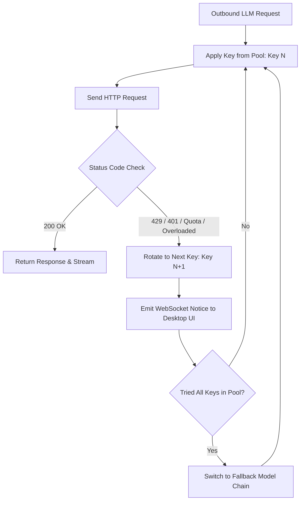

# API & LLM Integration Guide

NaviQ features a versatile LLM abstraction layer that connects to cloud APIs or local model runners. It includes multi-key load balancing, quota failover, and SSE tool call normalization.

---

## 1. Supported Providers

### 1.1. Google Gemini (Recommended)
- **Base URL**: `https://generativelanguage.googleapis.com/v1beta/openai`
- **Default Model**: `gemini-3.1-flash-lite`
- **Fallback Model**: `gemini-3.5-flash-lite`
- **Highlights**: Native support for multimodal audio transcription, extremely low latency, large context window (1M+ tokens), and cost efficiency.

### 1.2. OpenRouter
- **Base URL**: `https://openrouter.ai/api/v1`
- **Default Model**: `meta-llama/llama-3.3-70b-instruct:free`
- **Fallback Model**: `google/gemini-2.0-flash-exp:free`
- **Highlights**: Aggregates hundreds of commercial and open-source models with unified billing.

### 1.3. OpenAI
- **Base URL**: `https://api.openai.com/v1`
- **Default Model**: `gpt-4o-mini`
- **Fallback Model**: `gpt-3.5-turbo`
- **Highlights**: Consistent tool calling accuracy.

### 1.4. Local Ollama & LM Studio
- **Base URL**: `http://localhost:11434/v1` (Ollama) or `http://localhost:1234/v1` (LM Studio)
- **Recommended Models**: `llama3.2`, `qwen2.5-coder:14b`, `qwen2.5:32b`
- **Important**: To permit requests from browser extensions, set the CORS environment variable:
  - **Ollama**: Set `OLLAMA_ORIGINS="*"`
  - **LM Studio**: Enable "Enable CORS" in the local server settings.

---

## 2. Multi-Key Rotation Engine (`rotating-fetch.ts`)

Web automation tasks generate frequent tool calls. Free-tier or low-tier API keys frequently encounter:
- HTTP 429 (Rate Limit / Requests Per Minute exceeded)
- Quota Exhaustion (`RESOURCE_EXHAUSTED`)
- Temporary 503 Outages

NaviQ implements an intelligent rotation proxy wrapping the native `fetch` client:



### Key Features:
1. **Zero-Interruption Rotation**: If an active agent task gets throttled mid-sentence, NaviQ immediately retries the request using the next key in the configured array without crashing the task.
2. **Dual-Model Failover**: When all keys have exhausted their quota for the primary model, the engine switches to the secondary `fallbackModel`.
3. **SSE Tool Call Normalization**: Automatically normalizes tool-calling chunks across disparate OpenAI-compatible endpoints to ensure smooth stream decoding.

---

## 3. Configuration Schema

The settings payload persisted in `naviq-store.json` and synchronized over WebSocket:

```typescript
interface NaviQSettings {
  provider: 'gemini' | 'openrouter' | 'openai' | 'local' | 'custom';
  baseUrl: string;
  apiKeys: string[];
  model: string;
  fallbackModel: string;
  models?: string[];
}
```

### Entering Multiple Keys
In the Instruction Desk UI:
1. Click the **Model Pill** in the top navigation bar or the gear icon to open **Settings**.
2. Select your provider preset (e.g., *Google Gemini*).
3. In the **API Keys** field, enter multiple keys separated by newlines or commas:
   ```text
   AIzaSyA1111111111111111111111111111111111
   AIzaSyB2222222222222222222222222222222222
   AIzaSyC3333333333333333333333333333333333
   ```
4. Click **Save Settings**. The keys are instantly saved and synchronized to the browser extension.
