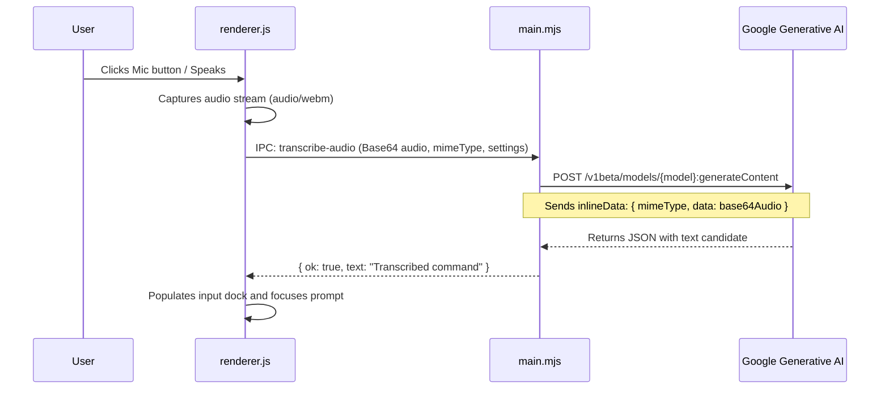

# Instruction Desk: Desktop App Deep Dive

The **Instruction Desk** is the user-facing command post of NaviQ, built with Electron, Node.js, and vanilla ES modules.

---

## 1. Directory Structure

```text
instruction-desk/
├── assets/
│   ├── icon.svg               # Scalable vector application logo
│   ├── icon.png               # High-res application icon (512x512)
│   ├── icon-128.png           # Mid-res icon
│   └── icon-32.png            # Window & taskbar icon
├── browser.mjs                # Puppeteer Chrome launch & profile manager
├── fixture.html               # Test page for automated verification
├── index.html                 # Main interface DOM layout and styling
├── main.mjs                   # Electron main process & WebSocket hub
├── package.json               # Node packaging and launch scripts
├── preload.cjs                # ContextBridge security isolation layer
├── renderer.js                # Frontend application logic and UI state
└── scripts/
    └── generate-icons.mjs     # Canvas-based PNG icon generation utility
```

---

## 2. Browser Automation Engine (`browser.mjs`)

The `browser.mjs` module automates the detection, profile cloning, and startup of Google Chrome.

### Chrome Binary Discovery
The launcher searches system paths in prioritized order:
1. Environment override `CHROME_PATH` (if defined and valid).
2. Puppeteer Cache (`~/.cache/puppeteer/chrome/**/chrome.exe`).
3. Standard Operating System Installations:
   - **Windows**: `C:\Program Files\Google\Chrome\Application\chrome.exe`, `C:\Program Files (x86)\...`, `%LOCALAPPDATA%\Google\Chrome\Application\chrome.exe`.
   - **macOS**: `/Applications/Google Chrome.app/Contents/MacOS/Google Chrome`.
   - **Linux**: `/usr/bin/google-chrome`, `/usr/bin/google-chrome-stable`, `/usr/bin/chromium`.

### Profile Isolation & Seeding
To prevent polluting the user's primary daily browsing profile (which could cause session lock collisions when Chrome is already running), NaviQ uses a dedicated user data root:
`%APPDATA%\NaviQ\chrome-profiles\<profileName>`

Users can choose between:
- **`default-isolated`**: A pristine, empty browser profile without cookies, extensions, or bookmarks.
- **System Profiles (`Default`, `Profile 1`, etc.)**: Automatically detects profiles from Chrome's `Local State` file. When selected, NaviQ performs non-destructive profile seeding:
  - Clones `Bookmarks`, `Preferences`, and `Secure Preferences` to ensure your search engines, layout preferences, and bookmarks are preserved.
  - Leaves the original Chrome directory untouched, avoiding lock contention (`SingletonLock`).

---

## 3. Gemini Multimodal Audio Transcription

NaviQ features zero-dependency voice input powered directly by Google Gemini's multimodal audio comprehension.

### Flow


### Model Failover Sequence
The transcription engine utilizes an intelligent fallback chain:
1. `gemini-3.1-flash-lite` (Preferred: ultra-low latency & high accuracy)
2. `gemini-3.5-flash-lite`
3. `gemini-flash-lite-latest`
4. `gemini-2.5-flash`
5. `gemini-3-flash`

If an API key returns HTTP 429 (quota exhausted) or HTTP 404 (model deprecated), the engine automatically tries the next model or next API key in the configured rotation pool.

---

## 4. UI Architecture & Features (`renderer.js`)

### Modern Dock & Chat Layout
- **Input Dock**: Sticky input dock with textarea auto-sizing, keyboard shortcuts (`Enter` to submit, `Shift+Enter` for newline).
- **Attachment Tray**: Displays pending image or file chips with real-time size counters and remove buttons.
- **Model Selector Pill**: Top toolbar chip showing the currently active model and number of configured keys. Clicking opens the Provider Modal.
- **Profile Selector Dropdown**: Real-time dropdown populated with all discovered Chrome profiles.
- **Interactive Tab Picker**: Displays tabs currently opened in Chrome, allowing the user to explicitly target one tab or allow the agent to select the active tab.

### Human-in-the-Loop Prompts
When an agent encounters a sensitive operation in `Ask` mode, a prompt card appears in the chat stream:
- Visual description of the action.
- Confirmation buttons: **Allow** or **Deny**.
- **Auto-Approve Toggle**: Allows the user to temporarily bypass prompts for the remainder of the session.

### Session Management & History
- Sessions are stored with UUIDs (`sess_<timestamp>_<rand>`).
- Supports session switching, title renaming, and deletion.
- **Export to Markdown**: Generates clean transcripts with timestamps, formatted code blocks, and tool results.
